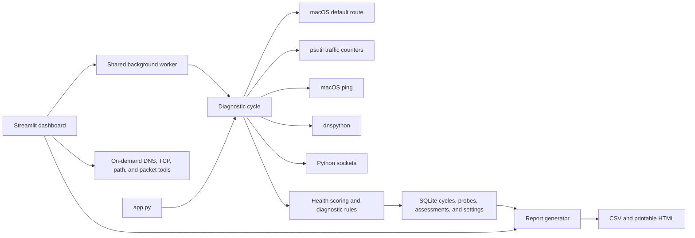

# NetPulse — Smart Network Health Monitor

NetPulse is a fifth-semester B.Tech Computer Networks project for investigating slow or unstable connections. A single ping leaves questions unanswered about name resolution, TCP connectivity, and local traffic. NetPulse measures these independently, records the evidence, and suggests troubleshooting steps with possible causes.

## Dashboard pages

| Page | What it does |
| --- | --- |
| Overview | Shows the latest real cycle, interface and gateway, local rates, health score, and probe details. Use **Run diagnostics** to take one reading. |
| Live Monitoring | Runs recurring diagnostics in the background and charts saved measurements over time. |
| Diagnostics | Shows observed symptoms, severity, possible causes, and recommended actions for the latest cycle. |
| DNS Analysis and TCP Connectivity | Run focused tests against selected domains and endpoints. |
| Network Path | Runs a bounded traceroute and lists the replies by hop. |
| Packet Analysis | Optionally summarizes authorized capture headers or imports PCAP and PCAPNG files. |
| Historical Reports | Filters SQLite history by UTC date and downloads CSV or printable HTML. |
| Settings | Saves targets, timeouts, the default interval, and analysis thresholds for future dashboard runs. |

## Run on macOS

Use Python 3.11 or newer on macOS. From the project directory:

```sh
python3 -m venv .venv
source .venv/bin/activate
python -m pip install -r requirements.txt
python -m streamlit run dashboard.py
```

Open [the local dashboard](http://127.0.0.1:8501). Select **Run diagnostics** to collect a first cycle. The server binds to localhost, and ordinary monitoring does not need administrator access.

The CLI prints JSON and saves to the same `data/netpulse.sqlite3` by default. Use `python app.py` for the default targets or supply overrides:

```sh
python app.py --ping 1.1.1.1 --ping 8.8.8.8 --dns example.com \
  --tcp example.com:443 --count 3 --timeout 2 --db data/netpulse.sqlite3
```

Repeat a target flag to add more targets to that test. Each flag overrides the corresponding defaults. Use brackets for IPv6 TCP endpoints, for example `--tcp '[::1]:443'`. NetPulse bounds the number of targets, ping attempts, and probe timeouts.

## Dashboard storage and settings

Set `NETPULSE_DB` before launching Streamlit to select a different SQLite file. The dashboard opens the latest saved cycle on startup. Older records remain readable, including records with unavailable scores or findings. Change dashboard settings from **Settings**. Changes are saved in that database and apply to the next manual diagnostic or monitoring start. CLI arguments configure CLI runs independently.

## Live monitoring and history

In the dashboard sidebar, select **Live Monitoring**, choose an interval of 5, 10, 30, or 60 seconds, and select **Start monitoring**. The first cycle starts immediately. Later cycles start after the selected interval and after the previous cycle has finished. The dashboard refreshes after a cycle is saved.

The worker is shared across browser sessions connected to this Streamlit process. It keeps running when you change pages or close a tab. **Stop monitoring** takes effect immediately in the controls and lets the current cycle finish and save. Monitoring stays off after restarting the server until you start it again.

**Measurement history** includes manual and recurring runs. Select a time range to view latency, ICMP loss, DNS response time, upload and download rates, and health scores. Charts use UTC and show up to the most recent 2,000 cycles in the selected range. Missing readings appear as gaps. Results and assessments persist in SQLite across server restarts.

## Reports

In **Historical Reports**, choose inclusive UTC start and end dates, then select **Generate report**. Both files use the same saved snapshot. Reports include their generation time and date range, interfaces, target and probe results, summary statistics, health scores, and diagnostic evidence with suggested actions. A large range returns the latest 500 cycles and marks the result as truncated.

- **CSV** uses `record_type` values `summary`, `cycle`, `probe`, and `finding`. Join detail rows to a cycle using `cycle_id`. Empty metric cells indicate unknown values.
- **HTML** is self-contained. Open the file in a browser and choose **Print → Save as PDF**. For a shorter printout, choose a narrower date range before exporting.

## On-demand diagnostics

- **DNS Analysis** compares lookup times for up to five domains. It shows resolved IPv4 and IPv6 addresses and lookup errors.
- **TCP Connectivity** tests up to five explicit endpoints. Use `host:port` or `[IPv6]:port`. The reported time is the TCP handshake only.
- **Network Path** sends one UDP probe per hop, up to 20 hops, using the macOS traceroute utilities. Hostnames use IPv4 traceroute. Enter an IPv6 literal for IPv6 traceroute. The view shows numeric hop addresses, round-trip times, and missing replies. A router can omit a reply while traffic continues to the destination.

These tools run separately from the monitoring schedule. Their results are available in the browser session.

## Optional packet analysis

Install Scapy inside the NetPulse environment:

```sh
python -m pip install -r requirements-packets.txt
```

Choose **Packet Analysis** in the sidebar. **Import PCAP** accepts an uncompressed PCAP or PCAPNG up to 16 MiB and inspects up to 5,000 packets without capture privileges. The browser session holds the uploaded file while it is selected. NetPulse displays only protocol counts and source/destination IP summaries, with no capture files or payloads written to SQLite.

**Live capture** requires authorization for the selected local interface and permission to open its macOS BPF device. Each run is limited to 10 seconds or 500 packets. Live capture is non-promiscuous and reads only the base IPv4 and IPv6 headers on supported Ethernet, loopback, and raw IP links. Tagged Ethernet traffic is skipped, and IPv6 traffic requiring extension headers for classification is reported as other IP. If macOS denies access, PCAP import and the rest of the dashboard remain available under your normal account.

## What a diagnostic cycle measures

| Measurement | What the result represents |
| --- | --- |
| Interface and gateway | macOS IPv4 default route, with an IPv6 route fallback, and IPs assigned to its interface. Interface state describes the local link. |
| ICMP | Round-trip times in milliseconds, loss as a percentage of transmitted probes, and jitter as the mean absolute difference between successive successful RTTs. Jitter needs at least two replies. A lack of replies can be caused by ICMP filtering or rate limiting. |
| Interface traffic | Upload and download in decimal Mbps from two cumulative interface readings spaced approximately one second apart. The rate uses actual monotonic elapsed time. This measures local traffic, including other applications and diagnostic traffic. It does not measure maximum ISP speed. |
| DNS | Duration of a lookup for IPv4 and IPv6 addresses using the configured resolver. DNS normally uses UDP and can fall back to TCP. |
| TCP | Duration of the successful socket handshake after DNS lookup, without a TLS or HTTP request. A successful connection establishes reachability to that tested endpoint. |

Unavailable measurements are JSON `null` and SQL `NULL`. The run-level status is `tcp_reachable` if any configured TCP endpoint accepts a connection. Otherwise it is `inconclusive`. Each individual probe has its own status and any available error detail.

## Architecture



The database saves each cycle, its probe rows, and its assessment in one transaction. Cycle timestamps are UTC and indexed for date-range queries. Report exports read a consistent SQLite snapshot while monitoring can continue writing.

Python handles orchestration, socket probes, and process timeouts. Streamlit and Plotly provide the UI and interactive charts. psutil supplies interface counters, dnspython performs DNS lookups, and the macOS command-line tools send ICMP and traceroute probes. Scapy is optional. SQLite persists results, pandas prepares report data, and pytest covers the offline test suite.

## Health score

NetPulse's 0–100 score is a project-defined diagnostic heuristic. It summarizes the configured probes and depends on the targets and protocols that were measurable.

| Component | Weight | Full credit | Zero credit |
| --- | ---: | --- | --- |
| ICMP mean RTT per target | 20% | At or below 50 ms | At or above 300 ms |
| ICMP packet loss per target | 25% | 0% | At or above 50% |
| ICMP jitter per target | 10% | At or below 10 ms | At or above 80 ms |
| DNS response time per domain | 20% | At or below 50 ms | At or above 500 ms, or a timeout, NXDOMAIN, or no address answer |
| TCP connections per endpoint | 25% | Successful connection | Refused, timed out, or unreachable |

Timed and loss components decrease linearly between their cutoffs. NetPulse averages available target scores within each component equally, then divides the weighted total by the sum of the available weights and rounds to the nearest integer. The score requires at least 45 percentage points of measured weight and evidence from at least two protocol families. Missing timings, execution errors, and TCP probes blocked at the DNS stage contribute no component evidence for those measurements. Measured ICMP loss can still affect the score when latency and jitter are unavailable.

Categories are **Excellent** (90–100), **Good** (75–89), **Fair** (50–74), **Poor** (25–49), and **Critical** (0–24). The CLI exposes measured weight and per-component scores so a result based on partial coverage is visible.

## Automated diagnosis

Rules flag per-target latency at 150 ms, ICMP loss at 10%, jitter at 30 ms, and DNS response time at 200 ms or higher. Other rules detect DNS resolution failures, TCP connection failures, and a confirmed down interface. Each finding includes severity, observed evidence, possible causes, and actions. ICMP filters, closed ports, and a domain-specific DNS failure can all affect results.

The traffic rule compares upload and download independently with the most recent cycle that has rates for the same interface within five minutes. A change must be at least 5 Mbps and at least 50% of the prior rate. A zero baseline uses the absolute cutoff. With insufficient coverage the overall diagnosis is inconclusive, while any observed findings are still shown. A confirmed down interface is reported even with insufficient coverage.

Pass `--thresholds` with a JSON file to override defaults. For example, save the following as `thresholds.json` and run `python app.py --thresholds thresholds.json`.

```json
{
  "score": {"latency_ms": [40, 250]},
  "diagnosis": {"latency_ms": 120, "traffic_change_mbps": 10}
}
```

The `score` section accepts `latency_ms`, `loss_percent`, `jitter_ms`, and `dns_ms` as pairs of full-credit and zero-credit cutoffs. The `diagnosis` section accepts those same names as single alert cutoffs, plus `traffic_change_mbps`, `traffic_change_percent`, and `traffic_baseline_max_age_seconds`. The dashboard **Settings** page accepts the same threshold JSON.

## Tests

```sh
python -m pip install -r requirements-dev.txt
python -m pytest -q
```

The tests mock external networking and use temporary SQLite files. Install the optional Scapy requirements to include the packet parsing and capture tests. Live measurements depend on local routing, network permissions, and the configured endpoints. VPNs can select a virtual default interface, and local counters can change as the host moves between networks.

## Offline demo

To demonstrate the charts and reports without sending any probes, use a separate dashboard process:

```sh
NETPULSE_DEMO=1 python -m streamlit run dashboard.py --server.port 8502
```

The demo copies five synthetic cycles from [the demo fixture](demo/cycles.json) into a temporary SQLite database. It labels the dashboard and both report formats as synthetic and disables live probes and capture. The live database stays separate.

## Screenshots

To reproduce the dashboard views with shareable synthetic data, launch the offline demo and open **Overview**, **Live Monitoring**, or **Historical Reports**. In Historical Reports, select **Generate report** to display the summary and both download controls.

## Limitations

- The command-based probes target macOS. A VPN can change the default interface and alter which local traffic the counters reflect.
- Diagnostic rules identify symptoms and plausible causes. DNS caching, ICMP filtering, upstream routing, and endpoint behavior can influence results.
- TCP tests stop after the handshake. Interface counters report local activity, so maximum ISP throughput requires a separate controlled test.
- Monitoring belongs to the local Streamlit process. Stopping the server ends monitoring, and restarting it reloads saved history.
- Live capture requires macOS BPF access for the chosen interface. PCAP import remains available under a standard account.

## Future improvements

Possible extensions include separate per-interface histories, scheduled retention for long monitoring sessions, configurable IPv4 and IPv6 traceroute selection for hostnames, and comparisons across multiple explicitly configured DNS resolvers.

For the project abstract, syllabus mapping, and viva preparation, see [PROJECT_EXPLANATION.md](PROJECT_EXPLANATION.md).
